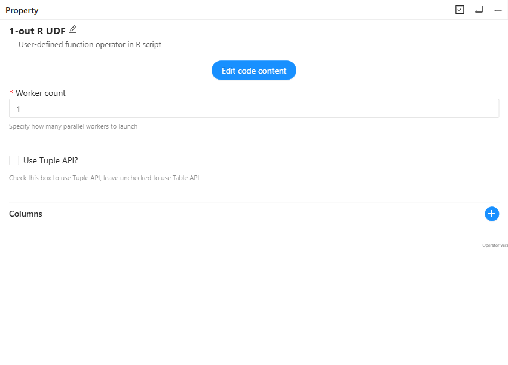
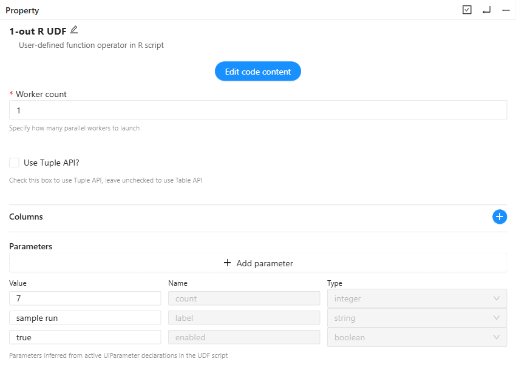

# R UI parameters: PR #9279 evidence

Native browser captures of the same local, disposable workflow and R source operator. Both views use an 850 x 610 pixel crop of the properties panel at the same viewport size. The images were not retouched.

| Existing UI | PR #9279 |
| --- | --- |
|  |  |

The before view uses the existing local frontend and backend metadata, which do not expose R UI parameters. The after view runs the PR frontend at source commit `3fa2e0778add4101a525837187a4827de64c9c73`, with the R schemas exported by this branch's actual Scala `OperatorMetadataGenerator`. A temporary proxy replaces only those two operator metadata entries; authentication and workflow persistence use the existing local backend. This is a UI comparison, not a deployment of every backend service from the branch. Commit `89b94d6c001b6fda8feb5567271061ee68167250` retries CI with no code changes.

Manual checks:

1. Create a fresh local test workflow and add a 1-out R UDF.
2. Enter the following declarations through the visible code editor.
3. Verify integer/string/boolean rows appear, and edit values to `7`, `sample run`, and `true`.
4. Reload the page and reopen the code editor: values persist and inferred names/types remain disabled.

```r
count <- UiParameter("count", AttributeType$INT)$value
label <- UiParameter("label", AttributeType$STRING)$value
enabled <- UiParameter("enabled", AttributeType$BOOL)$value
function() { data.frame(count=count, label=label, enabled=enabled) }
```

Execution is validated separately by the real R/rpy2/Arrow integration suite, including compiler-generated fixtures and all four R source/processing and tuple/table modes. The UI screenshot session did not execute a workflow.

These evidence files live on a separate branch in the author's fork, outside the source PR diff.
