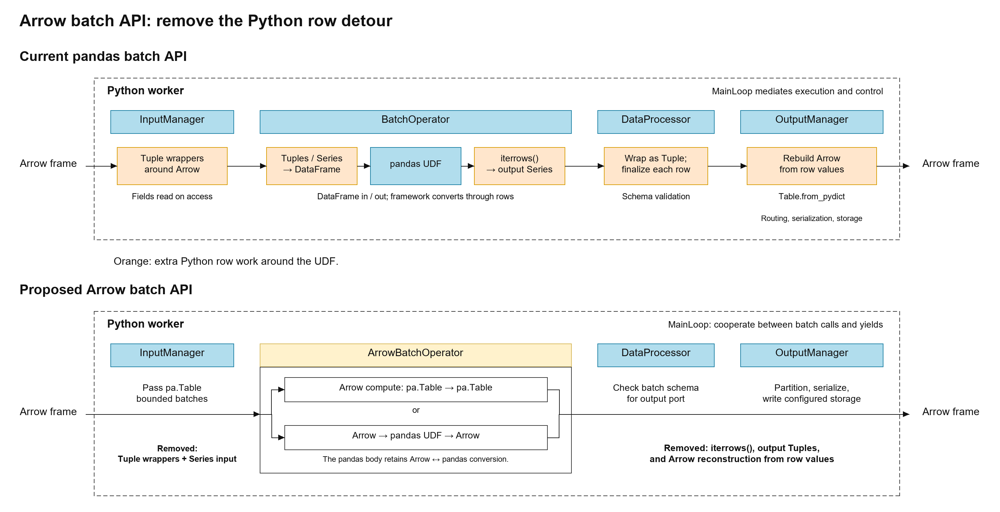

# Arrow batch API discussion evidence — November 4, 2026

Supporting material for [apache/texera discussion #8477](https://github.com/apache/texera/discussions/8477).

- [Editable draw.io figure](arrow-batch-combined.drawio)
- [Benchmark report and full matrix](benchmark/results.md)
- [Reproduction package](arrow-batch-benchmarks.zip)
- [Driver, samples, environment and source hashes](benchmark/)

These measurements cover conversion and UDF kernels in the existing audit checkout at ec3a9dd3ca9c361cbd7f339d8bc78669024e84e8. The direct paths are standalone benchmark prototypes. ArrowBatchOperator is not integrated into the engine, and these are not end-to-end workflow speedups. The report documents the excluded work and the Windows-specific local reproduction paths.

The figure uses existing component names. Orange steps are framework Python row work targeted for removal; the proposed row keeps Arrow across those positions. Batch schema validation, partitioning, serialization and configured storage remain responsibilities. The pandas UDF option retains Arrow/pandas conversion.
